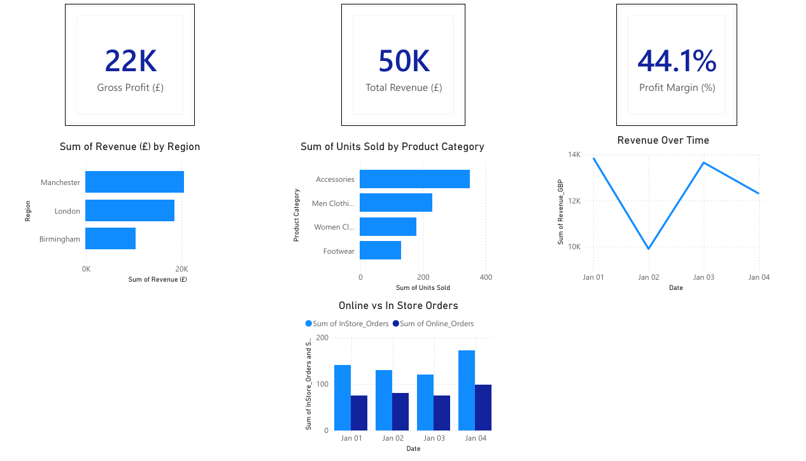

# Executive Business Analytics Dashboard | Power BI

An executive business intelligence dashboard and analytics case study for **Aurora Fashion Group**, an illustrative fashion retailer with online and in-store sales.

The project combines a Power BI Desktop report with a written business analytics specification. It focuses on KPI design, executive reporting, sales performance and profitability analysis.

## Dashboard preview

## Business objectives

- Give leadership a consolidated view of revenue, profitability, sales regions and channels.
- Help the CEO assess business performance and regional sales.
- Help the CFO monitor gross profit and profit margin.
- Help the Head of Marketing compare product categories and online versus in-store sales.

## Dashboard contents

The Power BI report contains seven visuals:

1. Total Revenue KPI card
2. Gross Profit KPI card
3. Profit Margin KPI card
4. Revenue by Region bar chart
5. Units Sold by Product Category bar chart
6. Revenue Over Time line chart
7. Online vs. In-Store Orders column chart

Example KPI definitions:

- **Total revenue** = Sum of revenue across transactions
- **Gross profit** = Total revenue - cost of goods sold
- **Gross profit margin** = Gross profit / total revenue * 100

## Files

| File | Purpose |
| --- | --- |
| `Aurora_Executive_Dashboard.pbix` | Power BI Desktop dashboard and data model |
| `Aurora_Executive_Analytics_Case_Study.pdf` | Executive requirements, KPIs, architecture proposal, and implementation considerations |
| `assets/executive_dashboard.png` | Dashboard preview from the case study |

## How to view

1. Open `Aurora_Executive_Dashboard.pbix` using Microsoft Power BI Desktop.
2. Review the dashboard visuals and, if needed, inspect the model and measures.
3. Read the PDF for the business context, stakeholder needs, KPI definitions and proposed architecture.

The Power BI model includes sample retail data. Refreshing the report from the original source may require configuring a local data source.

## Project scope

The `.pbix` file is a dashboard prototype. The accompanying report describes a **proposed** wider analytics solution, including ETL integration, a central data warehouse, governance and scheduled refresh. These proposed components are not represented as a production deployment in this repository.

## Skills demonstrated

`Power BI` · `Business Intelligence` · `KPI Design` · `Data Visualisation` · `DAX Measures` · `Business Requirements Analysis` · `Executive Reporting`
